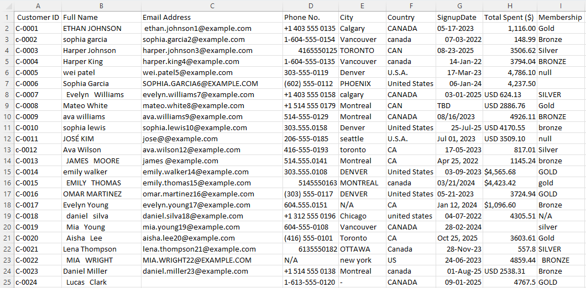
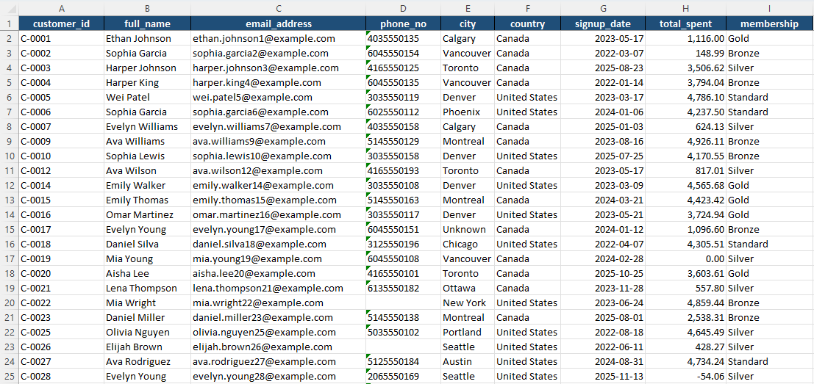
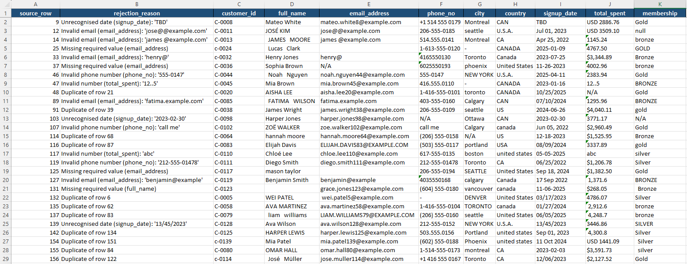
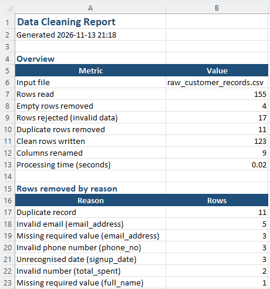
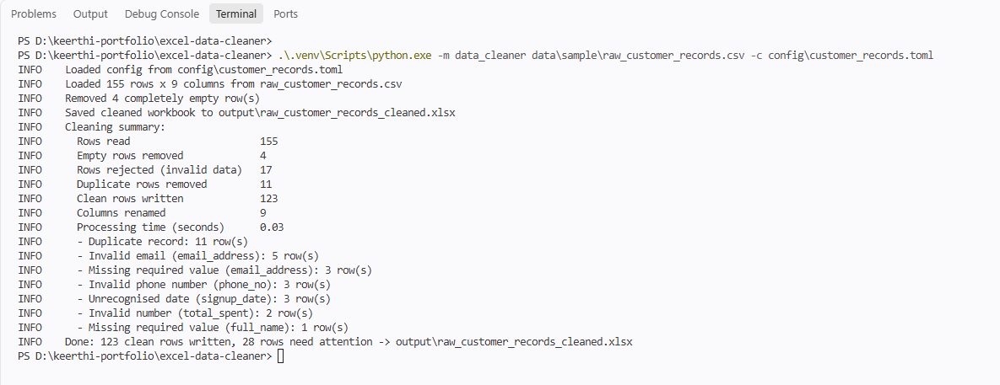

# Excel Data Cleaner

A Python command-line tool that turns messy CSV or Excel exports into a **clean, formatted Excel workbook**. It also produces a report of every change, so nothing is deleted silently.

   

---

## Problem statement

Data exported from CRMs, web forms, point-of-sale systems and hand-maintained spreadsheets is rarely ready to use. It typically has these problems:

- **Whitespace and casing:** stray spaces and inconsistent casing (`"  JOHN   smith "`).
- **Spelling variants:** the same value written several ways (`USA`, `U.S.A.`, `united states`).
- **Mixed date formats:** `2024-01-15`, `01/15/2024` and `Jan 15, 2024` in the same column.
- **Amounts stored as text:** values like `$1,234.50` or `Rs. 799` that Excel cannot add up.
- **Inconsistent phone numbers:** `(212) 555-0147`, `+1 212 555 0147` and so on.
- **Bad and incomplete records:** invalid emails, blank required fields, duplicate customers and empty rows.

Fixing this by hand takes hours and is easy to get wrong. **Excel Data Cleaner** does it in seconds, applies the same rules every time, and tells the client exactly what changed.

## Features

| Area | What it does |
|---|---|
| **Input** | Reads `.csv`, `.xlsx` and `.xlsm`. Lets you choose the worksheet and the CSV delimiter. Falls back through encodings for CSVs saved from Excel. |
| **Column names** | Converts headers to `snake_case` (`" Total Spent ($)"` → `total_spent`), fills in blank headers, and makes duplicate names unique. |
| **Text** | Trims and collapses whitespace. Recognises missing-value markers (`N/A`, `null`, `-`, …). Sets case per column (title, upper, lower, sentence). |
| **Value mapping** | Standardizes spelling variants (`usa` / `U.S.A.` → `United States`). |
| **Dates** | Parses mixed formats into real Excel dates. The list of formats is configurable, and invalid dates are reported. |
| **Numbers** | Removes currency symbols and codes (`$ € £ ₹ USD INR Rs.`) and thousands separators. Reads `(45.00)` as negative. |
| **Validation** | Checks email format. Normalises phone numbers to national digits, stripping the country code. |
| **Missing values** | Each column can be `leave`, `drop_row` or `fill:<value>`. Required columns are enforced. |
| **Duplicates** | Removes duplicates by key columns (e.g. `email`) or by entire row, keeping the first occurrence. |
| **Output** | Writes a styled workbook with a frozen header, filters, auto-sized columns, and real date/number formats. |
| **Traceability** | A *Rejected Rows* sheet keeps the original values, the spreadsheet row number and the reason for each removed row. A *Cleaning Summary* sheet gives the statistics. |
| **Configuration** | All rules live in a TOML file, so a new client file usually needs a new config, not new code. |
| **Logging and errors** | Logs to the console and to a detailed log file. Problems such as a missing file, an empty file, a bad config, or an output file open in Excel get clear error messages and a non-zero exit code. |

## Technologies used

- **Python 3.11+**
- **pandas**: tabular data processing
- **openpyxl**: Excel reading, writing and formatting
- **pytest**: unit and end-to-end tests
- Standard library: `argparse`, `logging`, `tomllib`, `re`, `dataclasses`, `pathlib`

The tool deliberately uses only two runtime dependencies.

## Installation

```bash
git clone https://github.com/keerthi-analytics-lab/excel-data-cleaner.git
cd excel-data-cleaner

python -m venv .venv
# Windows:
.venv\Scripts\activate
# macOS / Linux:
source .venv/bin/activate

pip install -r requirements.txt
pip install -e .
```

## Usage

Clean the sample customer list with its config file:

```bash
python -m data_cleaner data/sample/raw_customer_records.csv -c config/customer_records.toml
```

The output is `output/raw_customer_records_cleaned.xlsx`, and a detailed log is written to `logs/cleaner.log`.

More examples:

```bash
# Excel input: choose the sheet and the output file
python -m data_cleaner data/sample/raw_sales_orders.xlsx -c config/sales_orders.toml --sheet Orders -o output/sales_clean.xlsx

# No config: generic cleaning (column names, whitespace, missing markers, exact duplicates)
python -m data_cleaner any_file.csv

# Override the duplicate key from the command line; semicolon-separated CSV
python -m data_cleaner contacts.csv --dedupe-on email,phone --delimiter ";"

# Show every rejected row on screen
python -m data_cleaner data/sample/raw_customer_records.csv -c config/customer_records.toml --verbose
```

After `pip install -e .` the shorter command `data-cleaner` also works. Run `python -m data_cleaner --help` to see all options.

| Exit code | Meaning |
|---|---|
| `0` | Success |
| `1` | Input, config or output problem (the message explains what to fix) |
| `2` | Invalid command-line arguments |
| `3` | Unexpected error (details are in the log file) |

## Example input and output

**Input** (excerpt of a messy CSV):

| Customer ID | Full Name | Email Address | Phone No. | Country | SignupDate | Total Spent ($) |
|---|---|---|---|---|---|---|
| c-0001 | `␣␣zoë␣␣␣müller␣` | Zoe.Muller@Example.com | (212) 555-0147 | usa | 2024-01-15 | $1,234.50 |
| C-0002 | LIAM O'NEIL | liam@example.com | +1 312 555 0101 | U.S.A. | 03/07/2023 | USD 300 |
| C-0003 | Ava Smith | ava@example |  | CANADA | Mar 09, 2022 | (45.00) |
| c-0001 | Zoë Müller | `␣zoe.muller@example.com␣` | 212.555.0147 | US | 01/15/2024 | 1234.5 |

**Output: "Cleaned Data" sheet:**

| customer_id | full_name | email_address | phone_no | country | signup_date | total_spent |
|---|---|---|---|---|---|---|
| C-0001 | Zoë Müller | zoe.muller@example.com | 2125550147 | United States | 2024-01-15 | 1,234.50 |
| C-0002 | Liam O'Neil | liam@example.com | 3125550101 | United States | 2023-03-07 | 300.00 |

**Output: "Rejected Rows" sheet** (original values are kept so the source can be corrected):

| source_row | rejection_reason |
|---|---|
| 4 | Invalid email (email_address): 'ava@example' |
| 5 | Duplicate of row 2 |

**Output: "Cleaning Summary" sheet** reports:
- rows read, empty rows removed, rows rejected, duplicates removed and clean rows written
- rows removed, grouped by reason
- per-column counts of values corrected, missing values filled, invalid values and blanks left in the output
- the list of renamed columns

### Results on the sample files

| | Customer records (CSV) | Sales orders (Excel) |
|---|---|---|
| Rows read | 155 | 64 |
| Empty rows removed | 4 | 0 |
| Rejected (invalid / missing required data) | 17 | 5 |
| Duplicates removed | 11 | 4 |
| **Clean rows written** | **123** | **55** |

Each count matches the problems deliberately planted by the sample generator. For example, the customer file contains 5 invalid emails, 3 invalid phone numbers, 3 impossible dates, 2 non-numeric amounts, 4 records missing a required field, 8 reformatted duplicates and 3 exact duplicates.

Console output for the customer file:

```text
INFO    Loaded config from config\customer_records.toml
INFO    Loaded 155 rows x 9 columns from raw_customer_records.csv
INFO    Removed 4 completely empty row(s)
INFO    Saved cleaned workbook to output\sample\cleaned_customer_records.xlsx
INFO    Cleaning summary:
INFO      Rows read                      155
INFO      Empty rows removed             4
INFO      Rows rejected (invalid data)   17
INFO      Duplicate rows removed         11
INFO      Clean rows written             123
INFO      - Duplicate record: 11 row(s)
INFO      - Invalid email (email_address): 5 row(s)
INFO      - Missing required value (email_address): 3 row(s)
INFO      - Invalid phone number (phone_no): 3 row(s)
INFO      - Unrecognised date (signup_date): 3 row(s)
INFO      - Invalid number (total_spent): 2 row(s)
INFO      - Missing required value (full_name): 1 row(s)
INFO    Done: 123 clean rows written, 28 rows need attention -> output\sample\cleaned_customer_records.xlsx
```

The resulting workbooks are in [`output/sample/`](output/sample/).

## Screenshots

| Before: raw CSV | After: Cleaned Data |
|---|---|
|  |  |

| Rejected Rows | Cleaning Summary |
|---|---|
|  |  |



## Configuration

Rules are written in [TOML](https://toml.io). Column names refer to the **standardized** names. Every section is optional. See [`config/customer_records.toml`](config/customer_records.toml) for a complete, commented example.

```toml
[general]
acronyms = ["HD", "USB-C"]  # kept in capitals by title/sentence case

[columns]
required = ["customer_id", "email_address"]   # missing -> row rejected
emails   = ["email_address"]
phones   = ["phone_no"]
dates    = ["signup_date"]
numbers  = ["total_spent"]

[text_case]                 # title | lower | upper | sentence
full_name = "title"

[value_maps.country]        # case-insensitive replacements
"usa" = "United States"

[missing_values]            # leave | drop_row | fill:<value>
city = "fill:Unknown"

[duplicates]
subset = ["email_address"]  # empty list = compare entire rows

[dates]
formats = ["%Y-%m-%d", "%m/%d/%Y", "%b %d, %Y"]   # first match wins

[phones]
digits = 10
country_code = "1"

[excel]
date_format = "yyyy-mm-dd"
number_format = "#,##0.00"
```

The config is validated strictly. A typo such as `[colums]`, an unknown case such as `"camel"`, or a column that does not exist in the file stops the run with a clear message instead of being ignored.

## Running the tests

```bash
pytest
```

All 153 tests pass. They cover:
- each cleaning and validation function, with normal values, edge cases and invalid values
- config validation, including malformed TOML, unknown sections and invalid rules
- loading CSV and Excel files: encodings, sheets, 0-byte files, header-only files, corrupt workbooks
- the full pipeline: row accounting always balances, original values are preserved in the rejected rows, and an all-duplicates file is handled
- the Excel output: sheets, header styling, real dates and number formats
- end-to-end command-line runs on both sample files, plus every error path and its exit code

## Project structure

```
excel-data-cleaner/
├── src/data_cleaner/
│   ├── cli.py            # command-line arguments, exit codes
│   ├── config.py         # TOML loading + validation -> CleanerConfig
│   ├── loader.py         # CSV/Excel reading (everything as text)
│   ├── cleaners.py       # pure cleaning functions (text, numbers, dates, duplicates)
│   ├── validators.py     # email / phone / column checks
│   ├── pipeline.py       # runs the steps in order, tracks rejected rows
│   ├── report.py         # CleaningReport statistics
│   ├── exporter.py       # formatted three-sheet Excel workbook
│   ├── logging_setup.py  # console + file logging
│   └── exceptions.py     # user-facing error types
├── config/               # example rule files
├── data/sample/          # synthetic messy input files
├── output/sample/        # cleaned results produced from the samples
├── scripts/generate_sample_data.py   # reproducible sample data (fixed seed)
├── tests/                # pytest suite
├── docs/screenshots/
├── pyproject.toml
└── requirements.txt
```

### How it works

```
load (all text) → standardize column names → clean text / case / value maps
→ remove empty rows → missing-value rules → validate emails & phones
→ convert dates & numbers → move invalid rows to "Rejected Rows"
→ remove duplicates → write formatted workbook + summary
```

Each step is a small function. Value-level logic such as `parse_number("$1,234.50")` is separated from the pandas column handling, so every rule can be tested on its own.

## Assumptions and limitations

- **Header row:** the first row of the file or sheet must contain the column headers.
- **Ambiguous dates:** dates like `03/04/2024` are read using the *first* matching format in the config. Set day-first or month-first explicitly for each dataset.
- **Decimal separator:** numbers must use `.` as the decimal separator. European formats like `1.234,56` are not supported yet.
- **Phone numbers:** validation checks the number of digits (after removing the country code), not whether the number exists.
- **Emails:** validation checks the format only. It does not check whether the mailbox exists.
- **Duplicates:** detection is exact, after cleaning. Near-duplicates such as `Jon Smith` and `John Smith` are not merged.
- **File formats:** legacy `.xls` files are not supported. Save them as `.xlsx` first.
- **File size:** the whole file is processed in memory, which suits typical business files of up to a few hundred thousand rows.

## Future enhancements

- Simple web interface (Streamlit) for non-technical users
- Fuzzy duplicate detection (e.g. with `rapidfuzz`)
- Batch mode: clean every file in a folder
- Google Sheets input/output
- Configurable output column order and renaming
- Support for European number formats

## Sample data

All sample data is **synthetic**, generated by [`scripts/generate_sample_data.py`](scripts/generate_sample_data.py) with a fixed seed:
- Names are random combinations of common first and last names.
- Emails use the reserved `example.com` domain.
- Phone numbers use the `555-0100`–`555-0199` range, which is reserved for fictional use.

The files contain no real personal information.

## License

[MIT](LICENSE) © 2026 Keerthi
